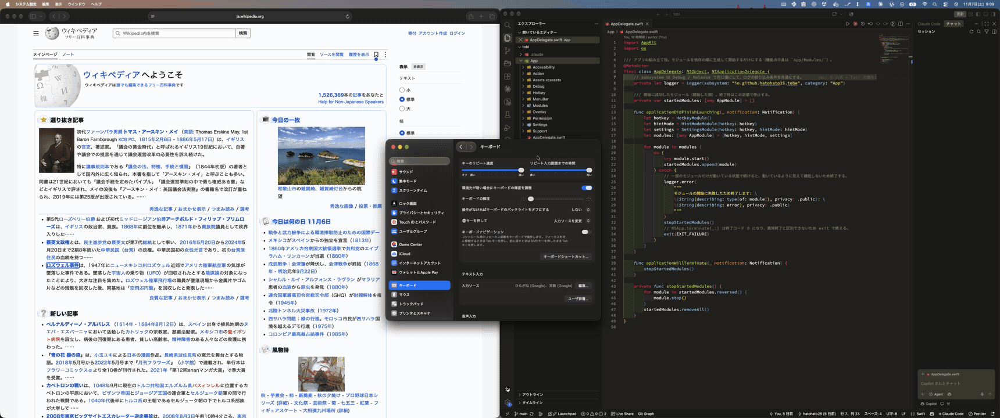

# Tobe

[English](README.md) | 日本語

**Tobe** は「飛べ」、または英語の "to be" と読みます。

Tobe は、[Vimium](https://github.com/philc/vimium) のヒントモードを macOS 全体で使えるようにするアプリです。右コマンドキーを単独でタップすると、ボタン、リンク、テキストフィールド、メニュー項目、タブなど、画面上のクリックできる要素に短いラベルが付きます。ラベルを入力すると、Tobe がその要素をクリックします。マウスやトラックパッドは必要ありません。



> **現在の状態: 初期リリース（0.2.2）。** 動作を確認している OS は macOS 26 と 27 だけです。問題が起きたら [Issue](https://github.com/hatohato25/tobe/issues) でお知らせください。

## 動作環境

- **macOS 15 以降。** それより古い macOS には対応していません。
- アクセシビリティの許可（[権限](#権限)を参照）。

## インストール

Homebrew の tap からインストールします。

```sh
brew install --cask hatohato25/tobe/tobe
```

### 初回起動（Tobe は公証されていません）

Tobe は自己署名証明書で署名しており、**Apple の公証を受けていません**。そのため、初めて開くときは Gatekeeper に止められます。次のどちらかの方法で開いてください。

- **システム設定:** 一度 Tobe を開こうとしたあと、**システム設定 > プライバシーとセキュリティ** で Tobe についてのメッセージを探し、**このまま開く** をクリックします。
- **ターミナル:** quarantine 属性を取り除きます。

  ```sh
  xattr -dr com.apple.quarantine /Applications/Tobe.app
  ```

### ダウンロードしたファイルの検証

各リリースは [GitHub Releases](https://github.com/hatohato25/tobe/releases) に zip ファイルで置いています。その SHA-256 チェックサムは Cask（[hatohato25/homebrew-tobe](https://github.com/hatohato25/homebrew-tobe) の `Casks/tobe.rb`）に記載しており、インストール時に Homebrew が自動で照合します。zip を自分でダウンロードした場合は、チェックサムを計算して Cask の `sha256` の値と比べてください。

```sh
shasum -a 256 Tobe-<version>.zip
```

アプリが Tobe の証明書で署名されていることも確認できます。出力に `Authority=Tobe Self-Signed` が含まれていれば問題ありません。

```sh
codesign -dv --verbose=4 /Applications/Tobe.app
```

## 権限

Tobe に必要な権限は **アクセシビリティ** だけです。画面上の要素を読み取ってクリックすることと、ヒントモード中に打ったキーを受け取ることに使います。

- **入力監視の許可は必要ありません。**
- 許可したあと、**Tobe を再起動する必要はありません。** Tobe が変更を検知して動き始めます。
- 許可を取り消すときは、先に Tobe を終了してください。[既知の制限](#既知の制限)を参照してください。

許可するには、Tobe の権限の案内で **システム設定を開く** を選びます。システムの言語が日本語の macOS 27 では、システム設定の「デバイスの制御とデータへのアクセス」が開きます。

## 使い方

1. **ヒントモードに入る:** **右コマンド（⌘）** キーを単独でタップします。ほかのキーを押さずに、300 ms 以内に押して離してください。⌘C などのショートカットは、これまでどおり使えます。
2. **ラベルを入力する:** ここまでの入力と一致しないラベルは隠れます。一致するラベルが 1 つになると、Tobe がその要素をクリックしてヒントモードを終えます。ラベルでは大文字と小文字を区別しません。また、あるラベルが別のラベルの先頭と一致することはありません。
3. **修正・取り消し:**
   - **Backspace** で、最後に打った文字を消します。
   - **Esc** で、クリックせずにヒントモードを終えます。⌘、⌃、⌥ を押したままでも使えます。

ヒントモード中に打ったキーは Tobe だけが受け取ります。使用中のアプリには届かないので、ラベルを入力してもテキストフィールドに文字が入ることはありません。

### 設定

設定画面は、メニューバーの Tobe のアイコンから開きます。次の項目を変更できます。

- 起動キー: **右コマンド（⌘）**（デフォルト）または **右オプション（⌥）**
- ラベルに使う文字。デフォルトは Vimium と同じ `sadfjklewcmpgh` です。
- ラベルの見た目（フォントサイズと色）
- ログイン時に開くかどうか

**デフォルトに戻す** を押すと、「ログイン時に開く」以外の設定が元に戻ります。設定画面、メニュー、権限の案内は、Mac の言語が日本語なら日本語で、それ以外なら英語で表示されます。

## 既知の制限

- **Tobe の実行中にアクセシビリティの許可を外す:** ヒントモード中には行わないでください。ある試験では、Mac を強制的に再起動するまで、すべてのアプリにクリックが届かなくなりました。許可を外すときは、先に Tobe を終了してください。
- **Secure Input:** Secure Input がオンの間、macOS はキー入力を Tobe に送りません。パスワードの入力欄や、ターミナルの「セキュアキーボード入力」が有効なときにオンになります。この間は、ヒントモードに入れないことがあります。
- **右コマンドキーの割り当てを変更している場合:** Karabiner-Elements や ⌘英かな などのツールで右コマンドキーの動作を変更していると、Tobe には変更後のキーが届きます。設定で起動キーを右オプション（⌥）に切り替えてください。
- **Web の中身:** Tobe が使えるのは、各アプリがアクセシビリティのツールに公開している要素だけです。
  - **Safari** は Web の中身を公開しているので、ページ内のリンクなどにもラベルが付きます。
  - **Electron アプリ（VS Code、Orca など）:** Tobe からアプリに、中身を公開するよう依頼します。この状態はアプリを終了するまで続くので、CPU とメモリの使用量が増えることがあります。アプリの起動直後は、中身にまだラベルが付かないことがあります。これらのアプリ内のターミナルでは、ターミナル全体とタブにラベルが付き、テキストの一つひとつには付きません。
  - **Chromium 系ブラウザ（Chrome、Edge、Brave など）:** 同じように、Tobe からブラウザに中身の公開を依頼します。この設定は、ブラウザの実行中にウインドウ管理ツールの動作に影響することがあります。
- **独自に UI を描画するアプリ:** WezTerm や多くのゲームなど、macOS の標準のコントロールを使わず、Metal などでウインドウ全体を自前で描画するアプリがあります。これらのアプリは中身をアクセシビリティのツールに公開しないので、ラベルが付くのはウインドウの枠だけです。
- **画面収録:** ⌘⇧5 で収録した動画には、画面上に出ているラベルが写らないことがあります。写したいときは、`screencapture -V <秒数> <ファイル名>.mov` で収録してください。
- **複数のディスプレイ:** 2 台のディスプレイでは動作を確認しています。Retina と非 Retina のディスプレイを混在させた場合や、「ディスプレイごとに個別の操作スペース」をオフにした場合は未確認です。

## ソースからのビルド

開発者向けの情報です。次のものが必要です。

- macOS 26 以降と Xcode 27 以降
- [XcodeGen](https://github.com/yonaskolb/XcodeGen) と [SwiftLint](https://github.com/realm/SwiftLint)。たとえば `brew install xcodegen swiftlint` でインストールできます。

### コード署名の証明書

Debug ビルドにも署名します。ad-hoc 署名のビルドは毎回別のアプリとして扱われるので、ビルドし直すたびにアクセシビリティの許可が外れてしまいます。このプロジェクトは、デフォルトでは **Tobe Self-Signed** という名前の証明書で署名します。証明書は次の手順で作成します。

1. **キーチェーンアクセス** を開き、**証明書アシスタント > 証明書を作成** を選びます。
   - 名前: `Tobe Self-Signed`
   - 固有名のタイプ: **自己署名ルート**
   - 証明書のタイプ: **コード署名**
   - **デフォルトを無効化** を選び、有効期間を 3650 日にします。証明書の期限が切れると、`codesign` で署名できなくなります。
2. キーチェーンアクセスで証明書を開き、**信頼** の **コード署名** を **常に信頼** にします。
3. 証明書が一覧にあることを確認します。

   ```sh
   security find-identity -v -p codesigning
   ```

4. `codesign` が初めて鍵を使うときに、macOS がキーチェーンへのアクセスを尋ねます。**常に許可** を選びます。

手持ちのコード署名証明書を使う場合は、`Config/Local.xcconfig.example` を `Config/Local.xcconfig`（git の管理対象外）にコピーし、`CODE_SIGN_IDENTITY` にその証明書の名前を設定してください。ad-hoc 署名（`-`）は使わないでください。

### ビルドとテスト

Xcode プロジェクトは `project.yml` から生成します。`Tobe.xcodeproj` を直接編集しないでください。

```sh
# Tobe.xcodeproj を生成する
xcodegen generate

# アプリをビルドする（Debug）
xcodebuild -project Tobe.xcodeproj -scheme Tobe -configuration Debug build

# コアロジックのユニットテストを実行する
swift test --package-path Packages/TobeCore
```

lint とフォーマットの確認:

```sh
swiftlint lint --strict
swift format lint --recursive --strict App Packages
```

Debug ビルドのアクセシビリティの許可をリセットするには、Tobe を終了してから次のコマンドを実行します。

```sh
tccutil reset Accessibility io.github.hatohato25.tobe.debug
```

## ライセンス

Tobe は MIT ライセンスで公開しています。[LICENSE](LICENSE) を参照してください。
