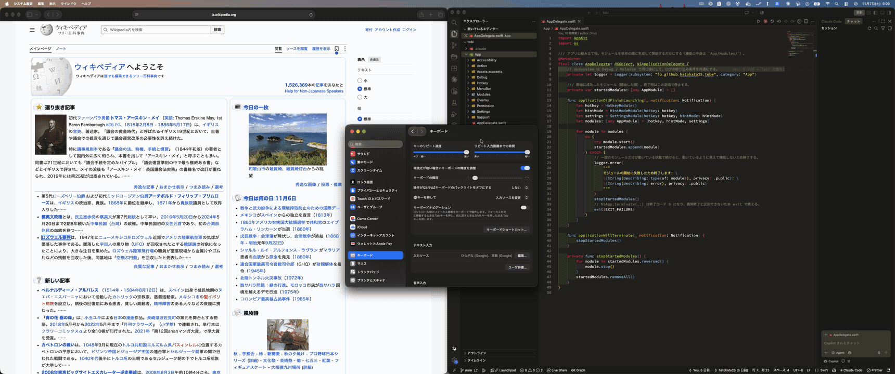

# Tobe

English | [日本語](README.ja.md)

**Tobe** — read as 飛べ ("Jump!") or as "to be".

Tobe brings the hint mode of [Vimium](https://github.com/philc/vimium) to all of macOS.
Tap the right Command key on its own and Tobe puts short labels on the clickable elements on
screen: buttons, links, text fields, menu items, tabs and so on. Type a label and Tobe
clicks that element. You don't need the mouse or trackpad.



> **Status: early release (0.2.2).** Tobe has been tested on macOS 26 and 27 only. If you run
> into a problem, please [open an issue](https://github.com/hatohato25/tobe/issues).

## Requirements

- **macOS 15 or later.** Older versions of macOS are not supported.
- Accessibility permission (see [Permissions](#permissions)).

## Installation

Install Tobe from its Homebrew tap. Homebrew doesn't load casks from non-official taps until
you trust them, so trust the Tobe cask first:

```sh
brew trust --cask hatohato25/tobe/tobe
brew install --cask hatohato25/tobe/tobe
```

### First launch (Tobe is not notarized)

Tobe is signed with a self-signed certificate. It is **not notarized by Apple**, so
Gatekeeper blocks it the first time you open it. Use one of these options to open it:

- **System Settings:** Try to open Tobe once. Then go to **System Settings > Privacy &
  Security**, find the message about Tobe, and click **Open Anyway**.
- **Terminal:** Remove the quarantine attribute:

  ```sh
  xattr -dr com.apple.quarantine /Applications/Tobe.app
  ```

### Verifying the download

Each release is a zip file on [GitHub Releases](https://github.com/hatohato25/tobe/releases).
Its SHA-256 checksum is recorded in the cask (`Casks/tobe.rb` in
[hatohato25/homebrew-tobe](https://github.com/hatohato25/homebrew-tobe)). Homebrew checks it
automatically when you install. If you download the zip yourself, compute the checksum and
compare it with the `sha256` value in the cask:

```sh
shasum -a 256 Tobe-<version>.zip
```

You can also check that the app is signed with the Tobe certificate. The output should
include `Authority=Tobe Self-Signed`:

```sh
codesign -dv --verbose=4 /Applications/Tobe.app
```

## Permissions

Tobe needs **Accessibility** permission only. It uses this permission to read the elements on
screen, click them, and catch the keys you type in hint mode.

- **Input Monitoring is not needed.**
- **You don't need to restart Tobe** after you grant the permission. Tobe notices the change
  and starts working.
- Quit Tobe before you revoke the permission. See [Known limitations](#known-limitations).

To grant the permission, select **Open System Settings** in Tobe's permission guide. On macOS 27
with the system language set to Japanese, this opens the 「デバイスの制御とデータへのアクセス」
screen in System Settings.

## Usage

1. **Enter hint mode:** Tap the **right Command (⌘)** key on its own. Press it and release it
   within 300 ms, without pressing any other key. Shortcuts such as ⌘C still work as usual.
2. **Type a label:** Labels that don't match what you've typed so far are hidden. When only
   one label matches, Tobe clicks that element and leaves hint mode. Labels are not
   case-sensitive, and no label is the start of another label.
3. **Correct or cancel:**
   - **Backspace** deletes the last character you typed.
   - **Esc** leaves hint mode without clicking. This works even if you hold ⌘, ⌃ or ⌥.

While hint mode is on, the keys you type go only to Tobe. The app you're using doesn't
receive them, so typing a label never inserts text into a text field.

### Settings

Open the settings window from the Tobe icon in the menu bar. You can change the following:

- The trigger key: **right ⌘** (default) or **right Option (⌥)**.
- The characters used for labels. The default is `sadfjklewcmpgh`, the same as Vimium.
- How labels look (font size and colors).
- Whether Tobe opens at login.

**Restore Defaults** resets everything except the open-at-login setting. The settings window,
menu and permission guide appear in Japanese if your Mac's language is Japanese, and in
English otherwise.

## Known limitations

- **Removing the Accessibility permission while Tobe is running:** Don't do this during hint
  mode. In one test, clicks stopped reaching every app until the Mac was force-restarted. To
  remove the permission, quit Tobe first.
- **Secure Input:** While Secure Input is on, macOS doesn't send keystrokes to Tobe. Secure
  Input is on in password fields and when a terminal's "Secure Keyboard Entry" is enabled.
  Hint mode might not start during this time.
- **Remapped right ⌘ key:** If a tool such as Karabiner-Elements or ⌘英かな changes what the
  right ⌘ key does, Tobe receives the changed key instead. Switch the trigger key to right ⌥
  in the settings.
- **Web content:** Tobe only uses the elements that each app makes available to accessibility
  tools.
  - **Safari** makes its web content available, so links and other elements in pages get labels.
  - **Electron apps (such as VS Code and Orca):** Tobe asks these apps to make their content
    available. They stay in this state until you quit them, which can use more CPU and memory.
    Right after an app starts, labels might not appear on its content yet. Terminals in these
    apps get labels for the whole terminal area and its tabs, not for each piece of text.
  - **Chromium browsers (such as Chrome, Edge and Brave):** Tobe asks these browsers to make
    their content available in the same way. This setting can affect window management tools
    while the browser is running.
- **Apps that draw their own UI:** Some apps, such as WezTerm and many games, draw their
  whole window themselves (for example with Metal) instead of using standard macOS controls.
  They don't make their contents available to accessibility tools, so only the window frame
  gets labels.
- **Screen recording:** Labels might not appear in recordings made with ⌘⇧5, even though they
  appear on your screen. To include them, record with
  `screencapture -V <seconds> <file>.mov` instead.
- **Multiple displays:** Tobe has been tested with two displays. It hasn't been tested with
  a mix of Retina and non-Retina displays, or with the "Displays have separate Spaces" setting
  turned off.

## Building from source

For developers. You need:

- macOS 26 or later, with Xcode 27 or later.
- [XcodeGen](https://github.com/yonaskolb/XcodeGen) and
  [SwiftLint](https://github.com/realm/SwiftLint). For example:
  `brew install xcodegen swiftlint`.

### Code signing certificate

Debug builds are signed too. Each ad-hoc signed build counts as a different app, so macOS
would remove the Accessibility permission after every rebuild. By default, the project signs
with a certificate named **Tobe Self-Signed**. To create one:

1. Open **Keychain Access** and choose **Certificate Assistant > Create a Certificate**.
   - Name: `Tobe Self-Signed`
   - Identity Type: **Self-Signed Root**
   - Certificate Type: **Code Signing**
   - Select **Let me override defaults** and set the validity period to 3650 days. After the
     certificate expires, `codesign` can't sign with it.
2. Open the certificate in Keychain Access. Under **Trust**, set **Code Signing** to
   **Always Trust**.
3. Check that the certificate is listed:

   ```sh
   security find-identity -v -p codesigning
   ```

4. The first time `codesign` uses the key, macOS asks for keychain access. Choose
   **Always Allow**.

To use a code signing certificate you already have, copy `Config/Local.xcconfig.example` to
`Config/Local.xcconfig` (it's ignored by git) and set `CODE_SIGN_IDENTITY` to your
certificate's name. Don't use ad-hoc signing (`-`).

### Build and test

The Xcode project is generated from `project.yml`. Don't edit `Tobe.xcodeproj` directly.

```sh
# Generate Tobe.xcodeproj
xcodegen generate

# Build the app (Debug)
xcodebuild -project Tobe.xcodeproj -scheme Tobe -configuration Debug build

# Run the unit tests for the core logic
swift test --package-path Packages/TobeCore
```

Lint and format checks:

```sh
swiftlint lint --strict
swift format lint --recursive --strict App Packages
```

To reset the Accessibility permission of the Debug build, quit Tobe and then run:

```sh
tccutil reset Accessibility io.github.hatohato25.tobe.debug
```

## License

Tobe is released under the MIT License. See [LICENSE](LICENSE).
